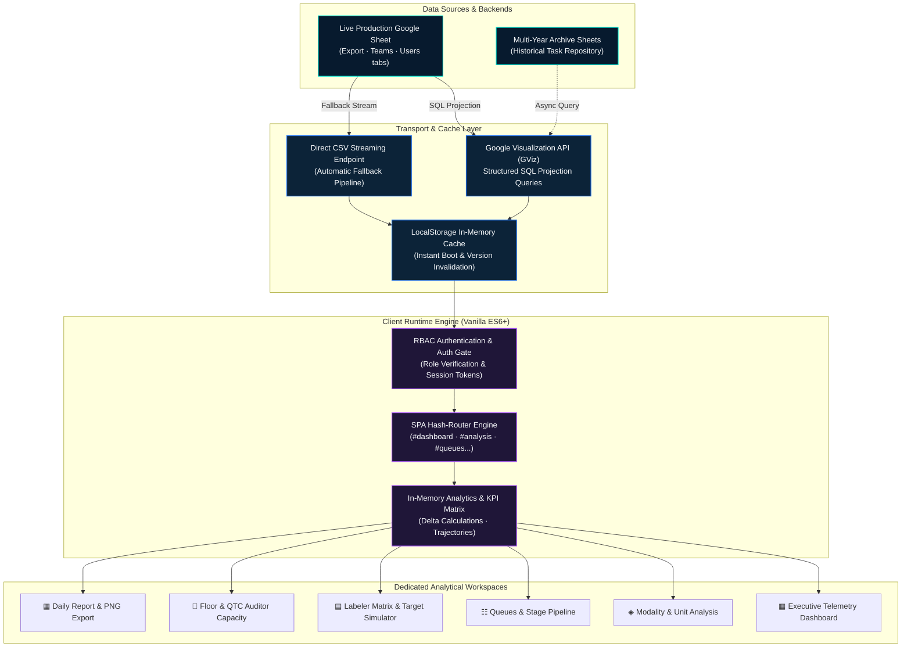

# ⚡ MEEG Productivity Workspace · METI Company

<div align="center">


[](https://github.com/islamyasser424-design/Meti-Internal-Dashboard)
[](https://github.com/islamyasser424-design/Meti-Internal-Dashboard)
[](https://github.com/islamyasser424-design/Meti-Internal-Dashboard)
[](https://github.com/islamyasser424-design/Meti-Internal-Dashboard)
[](https://github.com/islamyasser424-design/Meti-Internal-Dashboard)
[](#)

<p align="center">
  <strong>Enterprise Workforce Telemetry, Multi-Floor Operational Intelligence, and Quality Assurance Platform for High-Throughput Autonomous Vehicle (ADAS) Perception Annotation Pipelines.</strong>
</p>

</div>

---

## 📑 Table of Contents
- [Executive Summary & Business Context](#-executive-summary--business-context)
- [Operational Challenges & Engineered ROI](#-operational-challenges--engineered-roi)
- [System Architecture & Data Flow](#-system-architecture--data-flow)
- [Key Technical Innovations](#-key-technical-innovations)
- [The Six Dedicated Operational Workspaces](#-the-six-dedicated-operational-workspaces)
  - [1. ▦ Executive Telemetry Dashboard (`#dashboard`)](#1--executive-telemetry-dashboard-dashboard)
  - [2. ◈ Modality & Unit Analysis (`#analysis-overview`)](#2--modality--unit-analysis-analysis-overview)
  - [3. ☷ Project Queues & Bottleneck Mitigation (`#queues-analysis`)](#3--project-queues--bottleneck-mitigation-queues-analysis)
  - [4. ▤ Annotator Productivity & Target Simulator (`#performance-labelers`)](#4--annotator-productivity--target-simulator-performance-labelers)
  - [5. 🏢 Multi-Floor & QTC Auditor Capacity (`#performance-qtc-floor`)](#5--multi-floor--qtc-auditor-capacity-performance-qtc-floor)
  - [6. ▦ Longitudinal Daily Report & Snapshot Engine (`#daily-report`)](#6--longitudinal-daily-report--snapshot-engine-daily-report)
- [Multi-Shift Telemetry & Operational Routing](#-multi-shift-telemetry--operational-routing)
- [Bespoke Design System: Cyber-Glass](#-bespoke-design-system-cyber-glass)
- [Repository Structure](#-repository-structure)
- [Deployment & Setup Guide](#-deployment--setup-guide)
- [Security, RBAC & Governance](#-security-rbac--governance)
- [الدليل التعريفي والتشغيلي الشامل (باللغة العربية)](#-الدليل-التعريفي-والتشغيلي-الشامل-باللغة-العربية)
- [Author & Engineering Profile](#-author--engineering-profile)

---

## 📌 Executive Summary & Business Context

**Micro Engineering Egypt (MEEG) — A METI Company** manages high-volume production operations processing raw artificial intelligence training data for major autonomous vehicle (AV) manufacturers. Processing autonomous driving perception data requires orchestrating hundreds of annotators and quality assurance technicians across **three physical facility floors (Floor 01, Floor 02, Floor 03)** operating in continuous **24/7 rotating shifts**.

The data pipelines process multi-sensor perception payloads:
- **3D Lidar Point Clouds**: 3D bounding cuboid annotation, sensor fusion tracking, temporal ground-truth alignment, and 3D obstacle segmentation.
- **2D Camera Vision**: Multi-camera lane line boundary detection, free-space driveable polygon segmentation, and semantic object classification.
- **Hierarchical Quality Control (QA & QTC)**: First-pass (`FP`) labeling, second-pass inspection, and dedicated Quality Control Technician (`QTC`) defect pattern classification.

---

## 🎯 Operational Challenges & Engineered ROI

Before the deployment of this platform, shift supervisors and operations managers encountered significant operational hurdles:

| Operational Hurdle | Previous Spreadsheet Reality | MEEG Productivity Workspace Solution |
| :--- | :--- | :--- |
| **Data Fragmentation** | Shifts logged progress across disconnected spreadsheet tabs; compiling cross-shift throughput took 12–24 hours. | **Unified Single-Pane Telemetry**: Real-time aggregation of **15,000+ daily task transactions** with sub-16ms client-side filtering. |
| **Shift Transition Blindness** | Productivity dropped by 20–35% during shift handovers due to lack of visibility into in-flight task queues. | **Live Real-Time Telemetry**: Real-time traffic-light indicators (`tl-green`, `tl-yellow`, `tl-red`) and hourly throughput pacing. |
| **Multi-Floor Capacity Gaps** | Facility managers could not isolate whether bottlenecks were hardware, floor layout, or staffing related. | **Dedicated Multi-Floor Workspace**: Granular capacity tracking across Floor 01, 02, and 03 cross-referenced by shift. |
| **Reactive Quality Auditing** | Defect trends were audited after delivery, risking SLA penalties. | **Proactive QTC Defect Tracking**: Real-time error-pattern logging and instant individual first-pass accuracy scoring. |
| **Historical Archive Strain** | Querying multi-year historical logs caused browser crashes when opening 100k+ row spreadsheets. | **Asynchronous Streaming Modal (`arcs-ov`)**: Chunked background querying with real-time percentage progress bar. |

---

## 🏛️ System Architecture & Data Flow

The platform relies on a **Zero-Build, Serverless Client-Side Architecture** designed for zero latency, offline tolerance, and zero infrastructure maintenance costs:



---

## ⚡ Key Technical Innovations

### 1. Pure Vanilla ES6+ Zero-Build Philosophy
- Developed completely with standard **HTML5, Modern CSS Custom Properties, and Vanilla JavaScript**.
- **Zero build pipelines**: No Webpack, Vite, npm dependencies, or node_modules bloat.
- **Ultra-Lightweight Footprint**: Loads instantaneously over any connection; runnable directly from disk, private edge CDN, or GitHub Pages.

### 2. Dual Ingestion Protocol & Resilient Stream Fallback
- **Primary Engine**: Dispatches structured SQL-like projection queries via the Google Visualization API (`tq?tqx=out:json&tq=select * ...`).
- **Resilient Fallback**: Automatically switches to headless CSV stream parsing if Google GViz experiences rate-limiting.
- **Cache-First Hydration**: Immediately renders prior state from `localStorage` upon launch, while re-fetching fresh network telemetry asynchronously in the background.

### 3. Sub-16ms In-Memory Computation Engine
- Pre-indexes all task transactions into typed memory arrays.
- Filter adjustments (Date Range, Shift, Floor, QTC Reviewer, Modality) re-aggregate the entire dataset within **under 16 milliseconds** (within a single 60 FPS display frame), providing a buttery smooth user experience.

### 4. Dynamic Role-Based Access Control (RBAC)
- Authenticates users against the live Google Sheet `Users` directory without requiring external authentication servers.
- Automatic session invalidation tied to the HTML document `<meta name="app-version">` tag ensures immediate cache refresh across all client machines upon software updates.

### 5. High-Definition Executive Image Export
- Built-in `html2canvas` visual rendering pipeline: with a single click, supervisors generate a branded, high-contrast operational snapshot ready for direct pasting into Slack, Teams, or WhatsApp operational groups.

---

## 🗂️ The Six Dedicated Operational Workspaces

The platform provides a single-page application hash-router navigating between six dedicated operational hubs:

```
┌────────────────────────────────────────────────────────────────────────┐
│                        MEEG PRODUCTIVITY WORKSPACE                     │
├──────────────┬─────────────────────────────────────────────────────────┤
│ ▦ Dashboard  │ Real-Time Submissions · Active Workforce · Shift State  │
├──────────────┼─────────────────────────────────────────────────────────┤
│ ◈ Analysis   │ Modality Distribution (3D Lidar vs 2D Lane Line) · Units│
├──────────────┼─────────────────────────────────────────────────────────┤
│ ☷ Queues     │ Stage Pipeline Monitoring · Queue Bottleneck Mitigation │
├──────────────┼─────────────────────────────────────────────────────────┤
│ ▤ Labelers   │ Individual Velocity · Personal Quota · Quality Rate     │
├──────────────┼─────────────────────────────────────────────────────────┤
│ 🏢 QTC/Floor │ Multi-Floor Capacity Utilization · QTC Error Patterns   │
├──────────────┼─────────────────────────────────────────────────────────┤
│ ▦ Daily Rep. │ End-of-Day Aggregations · Sparkline Trajectories · PNG  │
└──────────────┴─────────────────────────────────────────────────────────┘
```

### 1. ▦ Executive Telemetry Dashboard (`#dashboard`)
The central operations room for real-time monitoring:
- **Macro KPI Indicators**: Total Submissions, Active Workforce Count, Quality Inspection Rate (`QA %`), and Queue Velocity (Tasks/Hour).
- **Peak Velocity Curves**: Hourly submission curves highlighting peak productivity windows and shift handover dips.
- **Live Status Heartbeat**: Live visual status badges reflecting data freshness and sync status.

### 2. ◈ Modality & Unit Analysis (`#analysis-overview`)
Specialized sensory stream inspection:
- Real-time volume split between **3D Lidar Point Clouds** and **2D Camera Vision**.
- Unit-level distribution benchmarks and throughput comparisons.
- Category breakdowns isolating pedestrian, vehicle, sign, and drivable surface densities.

### 3. ☷ Project Queues & Bottleneck Mitigation (`#queues-analysis`)
Production pipeline traffic management:
- Real-time tracking of active perception batches and stages (`First Pass`, `Quality Assurance`, `Sellmapping`).
- Shift and floor-level queue routing to prevent queue starvation or backlogs.
- One-click CSV export of queue data for operational shift handoffs.

### 4. ▤ Annotator Productivity & Target Simulator (`#performance-labelers`)
Granular individual productivity intelligence:
- Benchmarks individual annotator velocities against target shift baselines.
- **Interactive Quota Simulator**: Allows team leads to model hypothetical daily quotas and measure workforce feasibility in real time.
- Quality error scoring isolating high-accuracy annotators for complex perception scenarios.

### 5. 🏢 Multi-Floor & QTC Auditor Capacity (`#performance-qtc-floor`)
Spatial and quality supervisory management:
- Comparative capacity metrics across **Floor 01**, **Floor 02**, and **Floor 03**.
- Individual QTC auditor throughput, review turn-around times, and error escalation rates.
- Floor utilization benchmarking to ensure physical facility resources are balanced.

### 6. ▦ Longitudinal Daily Report & Snapshot Engine (`#daily-report`)
End-of-day executive governance:
- Multi-day trendlines visualized using zero-dependency inline SVG sparklines.
- Auto-compiled summary metrics ready for client delivery updates.
- Executive snapshot generator copying styled summary cards directly to the system clipboard.

---

## ⏱️ Multi-Shift Telemetry & Operational Routing

Enterprise operations at MEEG run across **8 distinct operational shifts**:

```
[24/7 ROTATING OPERATIONAL SCHEDULE]
├── Standard Operational Windows
│   ├── Morning Shift        (08:00 – 16:00)
│   ├── Night Shift          (16:00 – 00:00)
│   └── Over Night Shift     (00:00 – 08:00)
├── Surge 12-Hour Rotations
│   ├── Morning 12H          (08:00 – 20:00 Extended Peak)
│   └── O.Night 12H          (20:00 – 08:00 Extended Night)
└── Overtime Backlog Rotations
    ├── O.Shift (M)          (Morning Overtime Surge)
    ├── O.Shift (N)          (Night Overtime Surge)
    └── O.Shift (ON)         (Overnight Backlog Clearance)
```

The system dynamically detects active shift windows, filters metrics accordingly, and adjusts expected hourly run-rates automatically.

---

## 🎨 Bespoke Design System: Cyber-Glass

Engineered specifically for high-density analytical legibility and reduced eye fatigue during long 8-hour and 12-hour annotation shifts:

- **Dark Mode (Default)**: Deep midnight obsidian base (`#050a10`), cyber-neon cyan (`#00e5d4`), electric sapphire (`#1f6feb`), and subtle frosted glass cards (`rgba(9, 24, 39, 0.85)`).
- **Light Mode**: Crisp executive chrome backdrop (`#eef3f9`), structured slate framing, and high-contrast typography.
- **Typography**: Dual-font pairing with **Space Grotesk** for modern geometric UI headers and **JetBrains Mono** for numerical alignment, timestamps, and data grids.

---

## 📂 Repository Structure

```
Meti-Internal-Dashboard/
│
├── assets/
│   ├── dashboard-preview.svg      # Vector architectural UI mockup for documentation
│   └── meeg-logo.png              # Official MEEG / METI corporate identity asset
│
├── .gitignore                     # Repository hygiene & exclusion rules
├── .nojekyll                      # Disables Jekyll processing on GitHub Pages
├── dashboard-ui.css               # Modular design system, glass tokens & responsive styling
├── dashboard-ui.js                # Core SPA router, in-memory compute engine & workspace renderers
├── index.html                     # Application entrypoint, auth gate & ingestion runtime
├── LICENSE                        # Open-source MIT License
└── README.md                      # Comprehensive bilingual architecture & operations guide
```

---

## 🚀 Deployment & Setup Guide

### Local Execution
Because this platform has zero external build dependencies, running it locally requires no build step:

```bash
# 1. Clone repository
git clone https://github.com/islamyasser424-design/Meti-Internal-Dashboard.git
cd Meti-Internal-Dashboard

# 2. Launch with Python 3
python -m http.server 8000

# 3. Or launch with Node.js
npx serve .
```
Navigate to `http://localhost:8000` in Google Chrome or Microsoft Edge.

### Deploy to GitHub Pages (1-Click)
1. In your GitHub repository, navigate to **Settings** → **Pages**.
2. Under **Build and deployment**, select **Deploy from a branch**.
3. Choose branch `main` and folder `/ (root)`, then click **Save**.
4. The `.nojekyll` file included in this repository ensures all CSS, JS, and font assets are served cleanly without Jekyll intervention.

### Connecting to Custom Google Sheets
Open `index.html` and update the constants at the start of the configuration block:
```javascript
// Primary Google Sheet ID containing 'Export', 'Teams', and 'Users' tabs
const SHEET_ID = 'YOUR_GOOGLE_SHEET_ID_HERE';

// Historical Archive Google Sheet ID (queried asynchronously)
const ARCHIVE_SHEET_ID = 'YOUR_ARCHIVE_SHEET_ID_HERE';

// Cache invalidation & forced refresh tag
const AUTH_VER = 'v7';
```

---

## 🔒 Security, RBAC & Governance

> [!IMPORTANT]
> **Data Privacy & Governance**: All customer proprietary 3D LiDAR recordings, video frames, employee national IDs, and operational keys remain strictly protected under organizational access policies and read-only Google Workspace permissions. This repository houses the public front-end client implementation.

---

## 📖 الدليل التعريفي والتشغيلي الشامل (باللغة العربية)

### ما هي منصة MEEG Productivity Workspace؟
منصة تشغيلية وتحليلية داخلية مصممة خصيصاً لشركة **Micro Engineering Egypt (MEEG) — إحدى شركات مجموعة METI**، لإدارة ومتابعة عمليات توسيم وتدقيق بيانات الذكاء الاصطناعي وأنظمة القيادة الذاتية المتقدمة (**Autonomous Driving Perception**).

تتحكم المنصة في تدفق بيانات أكثر من **15,000 مهمة يومياً**، يشارك في إنتاجها مئات الموظفين والمشرفين الفنيين عبر **3 طوابق تشغيلية كاملة** وعلى مدار **24 ساعة يومياً (8 ورديات عمل)**.

---

### أبرز إمكانيات المنصة الهندسية:

1. **العمل الفوري بدون أي خوادم وسيطة (Zero-Build Vanilla Architecture):**
   - تم بناء النظام بالكامل بتقنيات الويب الأصلية (HTML5, Modern CSS Variables, Pure ES6+ JS) بدون أي مكتبات ثقيلة أو مراحل بناء (No Webpack / No Node.js).
   - سرعة فائقة وزمن تحميل شبه فوري مع معالجة وتصفية آلاف السجلات في أقل من 16 جزء من الثانية (Sub-16ms In-Memory Compute).

2. **الربط اللحظي والمزدوج مع Google Sheets:**
   - قراءة وتجميع البيانات لحظياً عبر واجهة **Google Visualization API (GViz)** باستعلامات SQL سريعة، مع التحويل التلقائي لتدفق CSV المباشر في حال انقطاع الشبكة.
   - نظام كاش ذكي (`localStorage`) يحفظ آخر نسخة محلياً لفتح لوحة التحكم فوراً بدون أي انتظار.

3. **مساحات العمل الستة المتخصصة:**
   - **لوحة المتابعة اللحظية (`#dashboard`):** تتبع إجمالي المهام، وسرعة الإنتاج في الساعة، ونسبة الجودة، وعدد الموظفين المتفاعلين لحظة بلحظة.
   - **تحليل الموداليتي والوحدات (`#analysis-overview`):** مقارنة دقيقة بين سحب النقاط ثلاثية الأبعاد (3D Lidar) وفيديو الكاميرات ثنائية الأبعاد (2D Lane Line).
   - **تحليل الكيوز ومراحل الإنتاج (`#queues-analysis`):** مراقبة طوابير المهام لمنع الاختناقات وتوزيع ضغط العمل بين الفرق.
   - **أداء الموظفين ومحاكي الإنتاجية (`#performance-labelers`):** جدول إنتاجية لكل موظف مع محاكي تفاعلي لتحديد مستهدفات الورديات ومتابعة دقة الإنجاز.
   - **أداء المشرفين واستيعاب الطوابق (`#performance-qtc-floor`):** مراقبة الطاقة الاستيعابية للطوابق الثلاثة (Floor 01, 02, 03) ومعدلات تدقيق فنيي الجودة (QTC).
   - **التقرير اليومي والتصدير الفوري (`#daily-report`):** ملخصات تنفيذية شاملة مع خاصية تصدير لقطة الشاشة عالية الجودة بضغطة زر لمشاركتها مع الإدارة.

4. **إدارة الورديات الثمانية:**
   - دعم كامل وتلقائي لـ 8 ورديات تشغيلية (الوردية الصباحية، المسائية، الليلية، ورديات الطوارئ 12 ساعة، وورديات الساعات الإضافية Overtime).

5. **نظام التصميم المزدوج (Cyber-Glass Dual Theme):**
   - واجهة داكنة مريحة للعين أثناء الورديات الليلية الطويلة مع إمكانية التبديل للوضع الفاتح بلمسة واحدة.

---

## 👨‍💻 Author & Engineering Profile

**Islam Yasser**  
*Workforce Management & Data Analytics Specialist*  
*Micro Engineering Egypt (MEEG) — A METI Company*  

- **GitHub Profile**: [@islamyasser424-design](https://github.com/islamyasser424-design)
- **LinkedIn**: [Islam Yasser](https://www.linkedin.com/in/islam-yasser-55048b378/)
- **Core Competencies**: Power BI, Advanced SQL, Python, WFM Telemetry, Workforce Optimization, Data Annotation QA & Cloud Data Synchronization.

---

<div align="center">
  <sub>Built with precision for METI Operations · Autonomous Vehicle Perception Infrastructure</sub>
</div>
